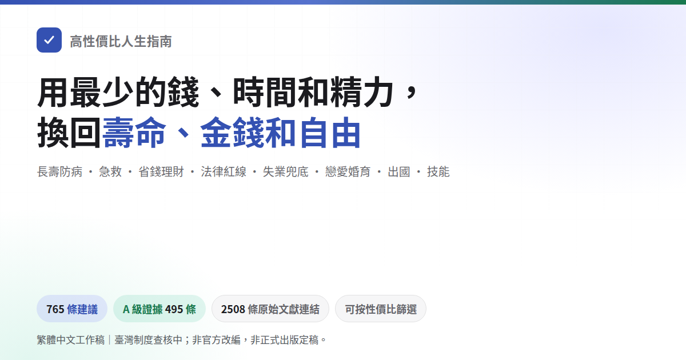

# HowToLiveBetter-TW｜台灣生活指南

這份指南整理台灣生活中常遇到的健康、安全、工作、居住與日常問題，說明可以採取的做法、適用情況、費用和風險，並附上參考資料。醫療、法律、福利和勞動權益會依個人條件、所在地與現行規定而異；遇到個案問題，可向主管機關或服務單位確認。

## 開始閱讀

[依章節找文章](locales/zh-TW/README.md) · [在電腦上閱讀及使用生活自我檢視](REPOSITORY_GUIDE.md#reading) · [製作離線閱讀檔](REPOSITORY_GUIDE.md#exports)

## 補充指引

[全民安全與防災準備](locales/zh-TW/guides/全民安全與防災準備.md) · [職業安全與健康](locales/zh-TW/guides/職業安全與健康.md)

## 閱讀前先看

搜尋和[章節目錄](locales/zh-TW/README.md)只列目前收錄的台灣指引。找不到主題時，可以換個關鍵字；目錄也沒有的主題，目前尚未整理相關指引。文章中的統計會標明期間和範圍；沒有可信的台灣統計時，會說明資料限制，不把案件數或服務人次當成個人發生機率。

在 GitHub 上直接開啟 HTML 檔會看到程式碼。要用瀏覽器閱讀，請依[閱讀說明](REPOSITORY_GUIDE.md#reading)在電腦上開啟閱讀頁面；也可以直接從[章節目錄](locales/zh-TW/README.md)閱讀文章。

## 原作與授權

原作內容對照頁保留原作者的文字與情境，方便查找和比對來源。要找台灣生活中的實際做法，請從[章節目錄](locales/zh-TW/README.md)閱讀。原作署名、授權和修改說明見[原作與修改說明](ATTRIBUTION.md)；原作對照方式見[閱讀說明](REPOSITORY_GUIDE.md#source-preview)。

原作文字及本 README 中標示的相關內容依 [CC BY 4.0](LICENSE) 授權；程式碼依 [MIT](LICENSE-CODE) 授權。轉載或改寫時，請保留原作署名、原始作品連結及修改說明。台灣指引的來源和再利用方式見[台灣內容治理政策](localization/TAIWAN_REUSE_POLICY.md)。
